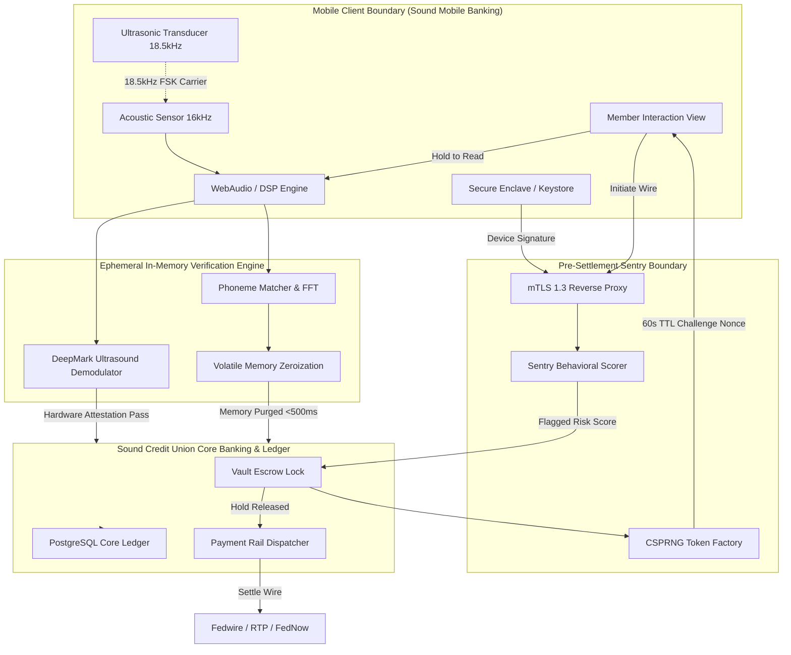
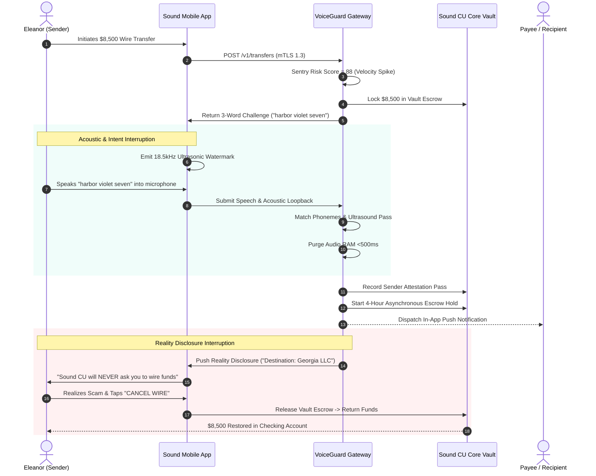

# VoiceGuard: Architecture & System Design Document

**System:** VoiceGuard™ Enterprise Protocol  
**Repository:** [Aayush1259/VoiceGuard](https://github.com/Aayush1259/VoiceGuard)  
**Target Financial Institution:** Sound Credit Union  
**Architecture Classification:** Pre-Settlement Escrow & Zero-Audio Acoustic Gateway  
**Date:** October 2026  

---

## 1. High-Level Architecture

VoiceGuard introduces a zero-trust pre-authorization boundary between the member’s mobile device and outbound payment rails.

---

## 2. Component Design & Responsibilities

### 2.1 Sound Mobile Banking Client
- **Presentation Layer:** Built with React 19 / Native Mobile Frameworks.
- **Audio Capture Subsystem:** Direct hardware stream capture at 16kHz PCM mono.
- **DeepMark Emitter:** Emits an inaudible ultrasonic carrier tone (18.5kHz) during the spoken challenge.
- **Secure Enclave Integration:** Signs transaction payloads with a hardware-attested private key (`ECDSA P-256`), preventing cloned devices or emulator execution.

### 2.2 Pre-Settlement Sentry Gateway
- **Ingress Layer:** Mutual TLS 1.3 termination with pinned intermediate certificates.
- **Sentry Risk Scoring Engine:** Analyzes velocity, payee novelty, transaction amount, and account age in `<15ms`.
- **Pre-Settlement Interceptor:** Automatically halts outbound settlement requests when risk exceeds threshold, redirecting the transaction to Vault Escrow.

### 2.3 Acoustic Verification Engine
- **In-Memory DSP:** Computes Fast Fourier Transforms (FFT) and extracts Mel-Frequency Cepstral Coefficients (MFCCs).
- **Phonetic Matching:** Matches the 3 randomly generated challenge words without creating or retaining biometric voice templates.
- **Acoustic Watermark Demodulator:** Extracts the frequency shift keying (FSK) data from the 18.5kHz carrier to confirm ambient physical room echo.
- **Zeroization Layer:** Calls `SecureZeroMemory` on all audio buffers within 500 milliseconds of capture.

### 2.4 Sound Credit Union Core Vault & Ledger
- **Vault Escrow Service:** Manages funds in escrow. Money never leaves Sound CU's balance sheet during the hold window.
- **Asynchronous Hold Coordinator:** Tracks the 4-hour expiration window for recipient attestation.
- **Audit Ledger:** Records immutable HMAC-SHA256 audit receipts (~350 bytes per verification) for NCUA exam readiness.
- **Settlement Rail Dispatcher:** Dispatches wire releases to Fedwire, RTP, or FedNow only upon receipt of cryptographic dual-presence verification.

---

## 3. End-to-End Transaction Flow

---

## 4. Hardware & Cryptographic Guarantees

1. **Non-Repudiation:** Transactions are tied to hardware cryptographic keys in the mobile phone's Secure Enclave.
2. **Anti-Deepfake Guarantee:** Pure software deepfakes cannot generate the physical acoustic loopback between phone speaker and microphone.
3. **Zero Audio Liability:** 100% compliant with **Washington RCW 19.375** and **UCC Article 4A**. No voiceprints, no stored audio, no privacy litigation exposure.
