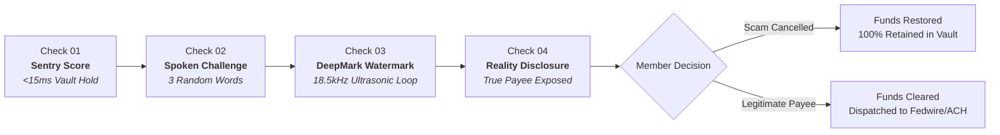

# VoiceGuard™ Enterprise Protocol

<div align="center">


**Verify both sides before money moves.**  
*Real-time pre-settlement vault hold, acoustic intent interruption, and dual-party presence defense.*

[Live Demo](#quickstart--running-locally) • [PRD](PRD.md) • [TRD](TRD.md) • [Architecture](ARCHITECTURE.md) • [Security Policy](SECURITY.md)

</div>

---

## 📌 Executive Overview

Every year, consumers and businesses lose over **$10.3 Billion** to Authorized Push Payment (APP) fraud and Business Email Compromise (BEC). 

Existing banking security authenticates the **login** (Face ID, SMS OTPs, passwords). However, in an authorized scam:
- **Criminals hack the human, not the application:** The legitimate member logs in with their real face and password because a criminal is coaching them over an active phone call.
- **Biometrics fail:** Face ID only proves *who* is looking at the camera; it cannot detect psychological panic, coercion, or deception.
- **SMS OTPs fail:** 92% of scam victims read SMS 6-digit codes directly to the fraudster.
- **Regulation E vacuum:** Because the member technically authorized the wire, federal law does NOT require banks to refund the loss.

**VoiceGuard** is Sound Credit Union's internal defense protocol. It pauses high-risk transactions inside the credit union vault before settlement, issues an unpredictable 3-word vocal challenge that shatters the scammer's trance, and mathematically proves physical acoustic reality.

---

## 🛡️ The 4 Pre-Settlement Checks



1. **⚡ Sentry Behavioral Scoring (<15ms):** Halts wire settlement in internal vault escrow before funds touch Fedwire, FedNow, or RTP.
2. **🎙️ In-App Spoken Challenge (60s TTL):** Generates 3 random phonetic words (`harbor • violet • seven`). Speaking aloud forces conscious critical thinking and breaks the telephone scam trance.
3. **🔒 DeepMark Ultrasonic Acoustic Attestation:** Broadcasts an inaudible 18.5kHz ultrasound chirp from phone speaker to microphone, proving physical room presence and defeating AI voice clones and soundboards.
4. **🛑 Cognitive Reality Disclosure:** Discloses the actual registered legal entity name of the destination account and confirms: *"Sound Credit Union will NEVER ask you to wire money to stay safe."* Victims cancel with 1-tap and 100% of their savings intact.

---

## 🌐 Supported Business Models

| Model | Target Threat | VoiceGuard Mechanism |
| :--- | :--- | :--- |
| **C2C (Peer-to-Peer)** | Elder family emergency & phone impersonation scams. | 3-word spoken challenge + 4-hour asynchronous vault escrow hold. |
| **B2C (Disbursements)** | Counterfeit remote job checks & overpayment refund demands. | 24-hour settlement buffer + cognitive questionnaire. |
| **C2B (High-Value Merchant)** | Real estate escrow diversion & unverified contractor accounts. | Dual-party verified corporate business matching in <45s. |
| **B2B (Commercial AP / Wire)** | Business Email Compromise (BEC) / CEO Wire Fraud ($2.9B FBI loss). | Dual-executive push: AP clerk initiates; CFO speaks random words to release. |

---

## ⏳ Asynchronous-First: Do Both Users Need to Verify at Once?

**No.** VoiceGuard is built for real-world asynchronous banking:
- **Sender verifies immediately (15 seconds):** Speaks the 3 words and goes about their day.
- **4-Hour Vault Escrow Hold:** Funds remain safely held inside Sound Credit Union.
- **Recipient verifies when free (within 4 hours):** Payee receives an authenticated push notification.
- **1-Tap Recall:** If the sender realizes they were targeted by fraud, they can tap **Cancel Transfer** anytime during the 4-hour window for an immediate 100% refund.

---

## ♿ Accessible Visual Fallback Mode (ADA Title III / WCAG 2.1 AA)

For members who cannot speak (illness, laryngitis, vocal disabilities, or noisy public spaces), VoiceGuard provides a **100% accessible fallback flow**:
- Secure Enclave hardware biometric re-authentication (Face ID / Touch ID).
- Interactive randomized word tap sequence.
- Guarantees zero members are locked out while preventing unauthorized bystander taps.

---

## 🏛️ Privacy & Compliance Architecture

- **Zero Audio Storage:** Audio exists solely in volatile device RAM for `<500ms` and is immediately purged using secure memory zeroization.
- **No Stored Biometric Templates:** VoiceGuard does NOT create, enroll, or store voiceprints, ensuring 100% compliance with the **Washington Biometric Privacy Act (RCW 19.375)** and **Illinois BIPA**.
- **No Call Recording:** VoiceGuard never taps, records, or intercepts cellular phone calls (compliant with federal wiretap laws and WA RCW 9.73.030).
- **Audit Receipt:** Generates an immutable 350-byte HMAC-SHA256 audit receipt for NCUA examiner review.

---

## 👥 Member Personas Simulated in Demo

- **👵 Eleanor Vance (M1001):** 74-year-old member targeted by an $8,500 "federal safe vault" phone scam. *Outcome: Eleanor cancels wire; $8,500 saved.*
- **🎓 Marcus Chen (M1002):** 19-year-old student targeted by a counterfeit $1,800 remote work check scam. *Outcome: Stopped before bounce.*
- **🔨 Sarah Jenkins (M1003):** 42-year-old member paying $6,500 to a licensed home contractor. *Outcome: Cleared smoothly in 40s.*
- **⚠️ Jordan Taylor (M1004):** 29-year-old nurse whose credentials were stolen for a 2:14 AM $9,200 crypto purchase. *Outcome: Blocked by hardware enclave lock.*

---

## 🚀 Quickstart & Running Locally

### Prerequisites
- Node.js 18+
- npm or pnpm

### Installation
```bash
# Clone the repository
git clone https://github.com/Aayush1259/VoiceGuard.git
cd VoiceGuard

# Install dependencies
npm install

# Start the interactive simulation dev server
npm run dev
```

Open your browser at:
```
http://127.0.0.1:5173/
```

### Production Build
```bash
npm run build
```

---

## 📚 Repository Documentation

- **[PRD.md](PRD.md):** Complete Product Requirements Document.
- **[TRD.md](TRD.md):** Technical Requirements & DSP Specifications.
- **[ARCHITECTURE.md](ARCHITECTURE.md):** System Design, Sequence Diagrams & State Machines.
- **[SECURITY.md](SECURITY.md):** Security Policy, Zero-Audio Guarantee & Responsible Disclosure.

---

## 📄 License & Trademark

Copyright © 2026 Sound Credit Union. All rights reserved.  
*Federally Insured by NCUA. Equal Housing Opportunity.*
