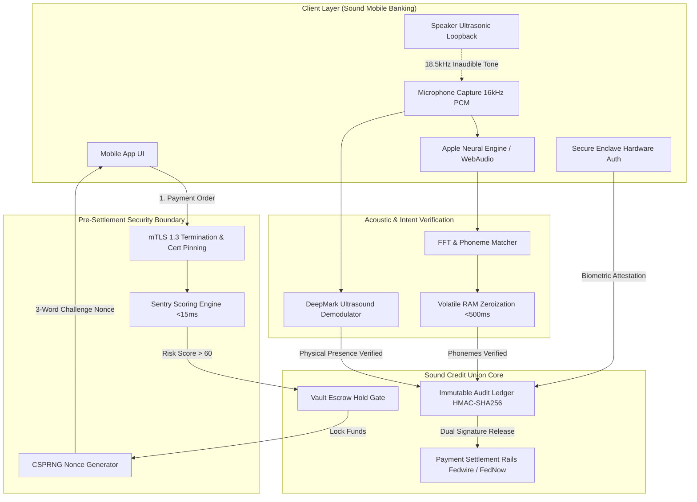
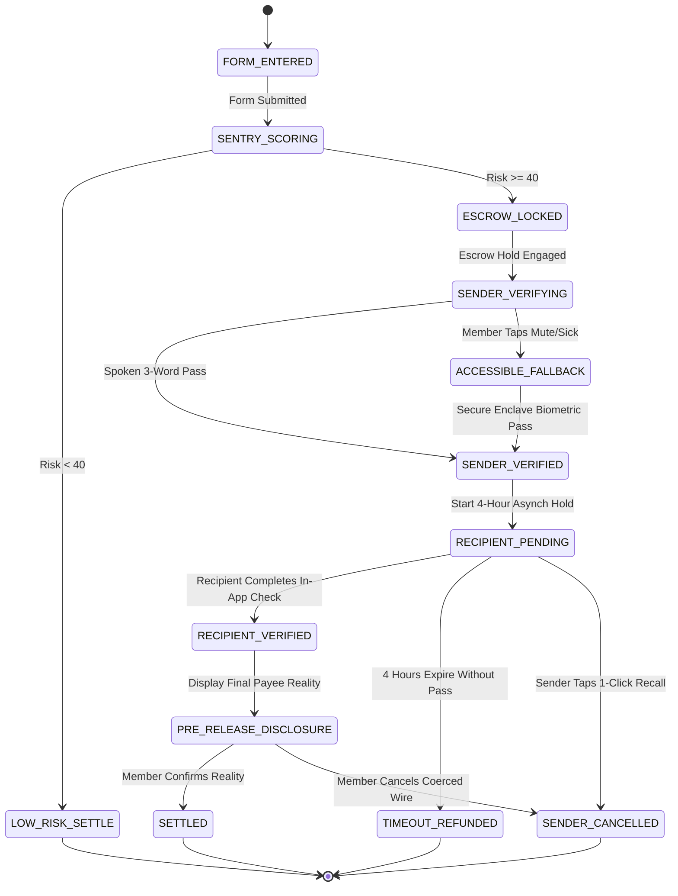

# VoiceGuard: Technical Requirements Document (TRD)

**System:** VoiceGuard™ Enterprise Protocol  
**Repository:** [Aayush1259/VoiceGuard](https://github.com/Aayush1259/VoiceGuard)  
**Classification:** Financial Tier-1 Security Infrastructure  
**Version:** 2.1  
**Date:** October 2026  

---

## 1. System Architecture Overview

VoiceGuard operates as a high-security pre-settlement verification gateway positioned between Sound Credit Union's Digital Banking Channels (iOS/Android mobile apps) and the Core Banking Settlement Rails (Fedwire, RTP, FedNow, ACH).



---

## 2. Cryptographic & Signal Processing Specifications

### 2.1 In-Transit Security: mTLS 1.3
- **Protocol:** TLS 1.3 with mandatory mutual authentication (mTLS).
- **Key Exchange:** Ephemeral Elliptic Curve Diffie-Hellman (`ECDHE-ECDSA-AES256-GCM-SHA384`).
- **Certificate Pinning:** The mobile client hardcodes Sound Credit Union’s intermediate certificate authority public key hash to prevent Man-in-the-Middle (MitM) attacks and rogue proxy interception.

### 2.2 Challenge Generation & Nonce Entropy
- **Generator:** Cryptographically Secure Pseudo-Random Number Generator (CSPRNG) backed by `/dev/urandom` / Windows CryptGenRandom.
- **Entropy:** 256 bits of systemic entropy.
- **Phonetic Mapping:** Entropy is mapped to an index of 2,048 phonetically distinct, low-ambiguity dictionary words (e.g. BIP-39 subset).
- **Lifespan (TTL):** Exactly 60 seconds. A nonce can be submitted only once (`Nonce_Status: BURNED`).

### 2.3 Audio Zeroization & Volatile Memory Lifecycle
- **Audio Capture Spec:** 16kHz sample rate, 16-bit mono PCM.
- **No Disk I/O:** Audio streams directly to volatile device RAM. Zero bytes are written to flash storage, cache, or external disk.
- **Processing Window:** Total speech recognition latency is `<500ms`.
- **Memory Zeroization:** Immediately following phonetic matching, the memory buffer is explicitly scrubbed using secure zero-overwrite (`memset_s` / `SecureZeroMemory`):

```c
// Cryptographic zeroization of ephemeral speech buffer
void purge_audio_buffer(volatile char *buffer, size_t len) {
    if (buffer == NULL) return;
    SecureZeroMemory((void*)buffer, len);
}
```

### 2.4 DeepMark Ultrasonic Acoustic Watermark
- **Purpose:** Mathematically blocks AI voice clones (ElevenLabs, DeepSeek audio models), soundboard playback, and virtual audio cables (VB-Audio / Loopback drivers).
- **Carrier Frequency:** `18,500 Hz – 20,000 Hz` (imperceptible to human ears, within standard smartphone speaker/mic fidelity).
- **Modulation:** Frequency Shift Keying (FSK).
- **Attestation Mechanism:**
  1. Phone speaker broadcasts an inaudible ultrasonic chirp encoding `SessionID + ChallengeNonce`.
  2. The physical microphone records ambient sound, capturing room reverberation and the ultrasonic tone.
  3. The acoustic engine performs bandpass filtering (`18kHz–22kHz`) and demodulates the FSK signal.
  4. If the acoustic watermark is absent or mismatched, the system flags **Virtual Soundboard / AI Audio Injection** and halts settlement.

---

## 3. Database Schema & Storage Model

To maintain 100% compliance with **Washington RCW 19.375** and federal privacy standards, **VoiceGuard stores zero voice recordings and zero biometric templates**.

### 3.1 Immutable Audit Log Entry (~350 Bytes)
Stored in Sound Credit Union’s core PostgreSQL / Oracle relational ledger:

```json
{
  "audit_receipt_id": "vg_rec_8921a4f0",
  "transaction_id": "TX-2026-892144",
  "member_id": "M1001",
  "recipient_account_hash": "sha256:e3b0c44298fc1c149afbf4c8996fb92427ae41e4649b934ca495991b7852b855",
  "wire_amount_cents": 850000,
  "currency": "USD",
  "risk_score": 88,
  "sentry_flags": ["VELOCITY_SPIKE", "NEW_PAYEE", "COERCION_AMOUNT"],
  "challenge_nonce_hash": "sha256:7b52009b64fd0a2a49e6d8a939753077792b0554",
  "words_matched": true,
  "phonetic_confidence": 0.964,
  "ultrasonic_watermark_passed": true,
  "acoustic_latency_ms": 384,
  "settlement_action": "USER_CANCELLED_POST_DISCLOSURE",
  "escrow_hold_released": false,
  "timestamp_utc": "2026-10-18T07:15:22Z",
  "hmac_signature": "e7f12a849b2c8e310023d8fa5b..."
}
```

- **Storage Footprint:** 1,000,000 transactions = **~350 Megabytes**.
- **Feasibility:** Fits seamlessly into existing relational core databases without requiring petabyte object stores or specialized vector DBs.

---

## 4. State Machine & Asynchronous Processing

VoiceGuard operates an asynchronous-first state machine. Senders and recipients never need to coordinate real-time simultaneous phone calls:



---

## 5. Security & Threat Mitigation Matrix

| Threat Vector | Attack Mechanism | Traditional Defense | VoiceGuard Defense |
| :--- | :--- | :--- | :--- |
| **Phone Impersonation** | Scammer poses as fraud agent; directs victim to approve wire. | Face ID passes; SMS OTP read aloud by victim. | **System 2 Vocal Interruption:** Unexpected 3 words shatter compliance trance; payee LLC disclosed. |
| **Generative AI Deepfakes** | Clone of member's voice via ElevenLabs / DeepSeek audio models. | Standard speech models fooled by synthetic pitch. | **DeepMark Ultrasonic Loopback:** Physical speaker-to-mic acoustic resonance proves room reality. |
| **SIM Swapping / SS7** | Criminal hijacks member's phone number to intercept codes. | SMS OTP captured by criminal; wire releases. | **Device-Bound mTLS & Enclave Key:** Codes are not sent via SMS; authenticated through in-app session. |
| **Virtual Audio Drivers** | Criminal injects audio directly into phone via USB/audio cable. | Software filters accept digital audio file. | **Acoustic Air-Gap Attestation:** Virtual sound drivers cannot produce ambient acoustic reverberation. |
| **Speech Disability / Illness** | Member has laryngitis, vocal impairment, or is in public. | Member blocked from funds or forced to use vulnerable SMS. | **Accessible Visual Fallback:** Hardware Face ID re-auth in Secure Enclave + random tap challenge (ADA compliant). |

---

## 6. Development & Deployment

### 6.1 Technology Stack
- **Frontend / Client Simulation:** React 19, Vite, Tailwind CSS v4, Lucide Icons, Zustand state engine.
- **Audio Signal Emulation:** Web Audio API (`AudioContext`, `AnalyserNode`, `OscillatorNode` for ultrasound simulation).
- **Core Simulator:** Pre-settlement state controller with real-time reactive pipeline visualization.

### 6.2 Running Locally
```bash
git clone https://github.com/Aayush1259/VoiceGuard.git
cd VoiceGuard
npm install
npm run dev
```
Runs at `http://127.0.0.1:5173/`.
